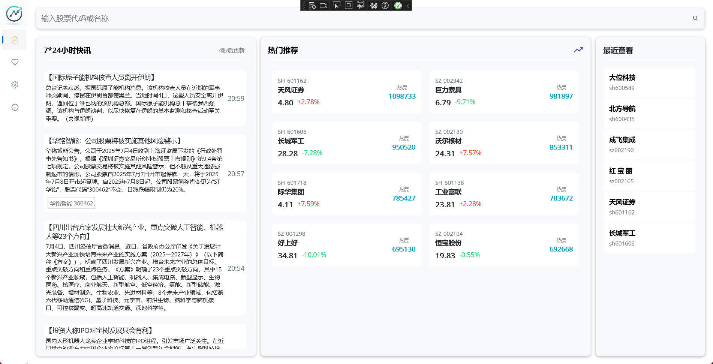
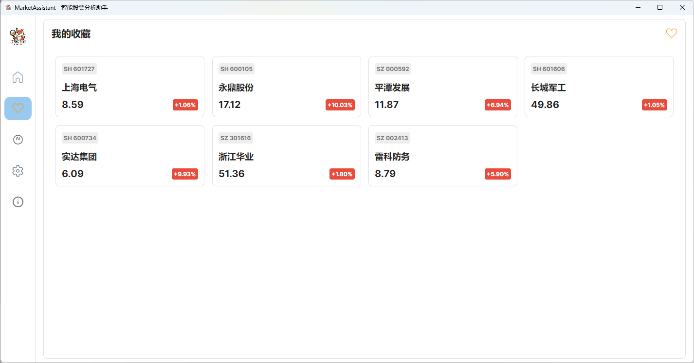
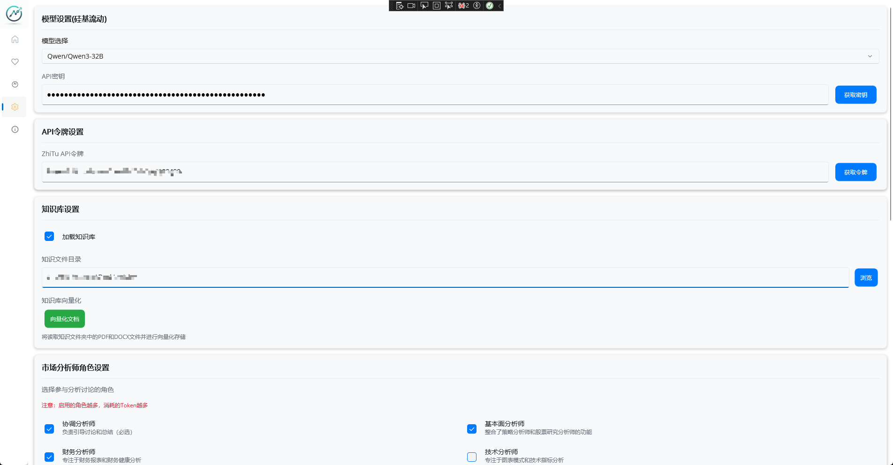
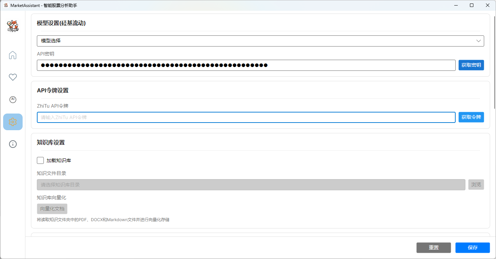
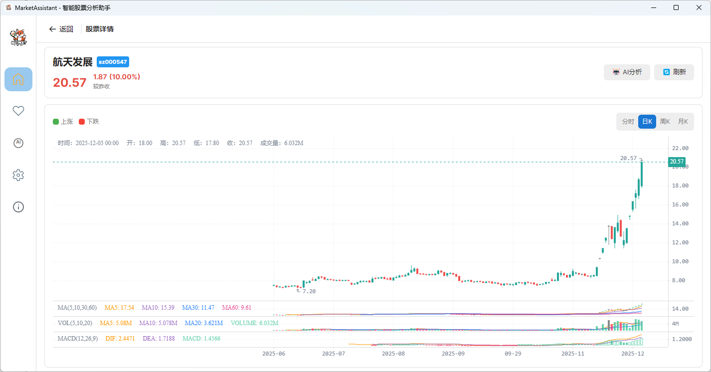
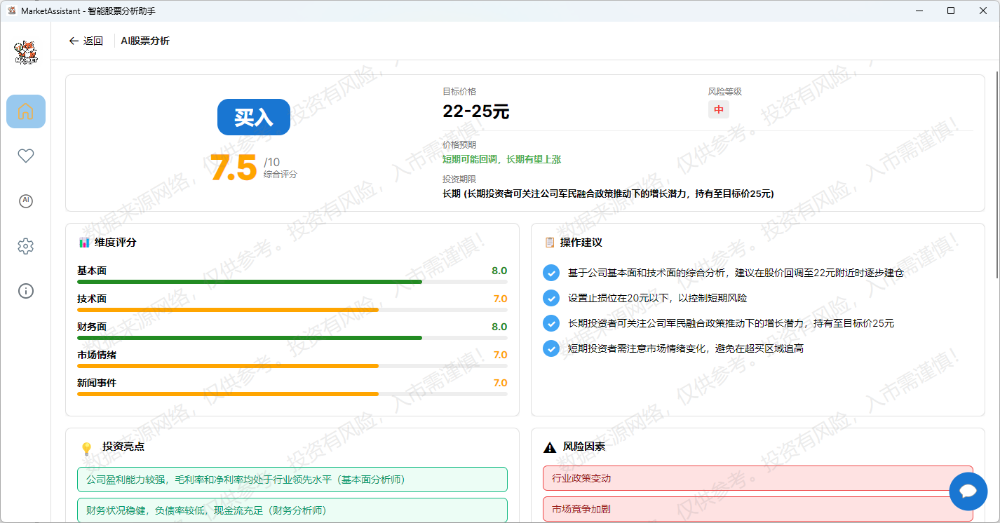

## ✨ 简介

本项目基于 Avalonia UI 开发，结合 AI 大模型构建的跨平台金融市场分析工具。目前已支持 **A 股** 和 **虚拟币（Crypto）** 两个市场，通过多 AI 分析师并行协作，自动化生成多维度投资分析报告。

基于实时数据，利用 AI 分析大量金融数据，提供动态实时洞察。快速汇集相关信息，全面审核整个情况，旨在为投资者、交易员和研究者提供专业的分析参考。

本项目仅供学习研究，投资有风险，入市需谨慎。

## 🧱 架构概览

- `MarketAssistant.App`：Avalonia UI 宿主，只负责视图、ViewModel、导航、通知、样式和内容文件输出。
- `MarketAssistant.App.Services`：应用运行时与业务编排层，承载 Agent 实现、Workflow、Tool 实现、RAG、MCP、交易引擎和业务服务。
- `MarketAssistant.Agents`：Agent 契约层，定义分析师基类、工具抽象、分析模型和提示词配置加载。
- `MarketAssistant.DataProviders`：外部行情与资讯数据接入层。
- `MarketAssistant.Trading`：交易抽象与共享交易模型。
- `MarketAssistant.Rag`：RAG 基础能力层（文档解析、向量化、检索、重排）。
- `MarketAssistant.Infrastructure`：基础设施层（模型发现、Token 化、结构化输出校验）。
- `MarketAssistant.Core`：基础模型、异常、转换器和市场枚举等通用能力。

当前依赖关系为：`Core` 无依赖；`Rag` 依赖 `Core`/`Infrastructure`；`DataProviders` 依赖 `Core`；`Agents` 依赖 `Core`/`Trading`/`Infrastructure`；`Infrastructure` 依赖 `Core`；`Trading` 依赖 `Core`；`App.Services` 依赖 `Core`/`Agents`/`Trading`/`DataProviders`/`Rag`/`Infrastructure`；`App` 依赖 `Core`/`Agents`/`Trading`/`DataProviders`/`App.Services`/`Rag`。

## 📊 主要功能

### 多市场支持

- **A 股市场**：股票搜索、基本面/技术面/财务/情绪/新闻五维分析
- **虚拟币市场**：支持 Binance 实时行情、K 线、资金费率、多空比等数据

### 统一告警中心

- **三类告警统一出口**：价格告警、风险告警、AI 信号告警
- **降噪机制**：同类告警 5 分钟合并窗口 + 全局每小时配额（Critical 不受限）
- **联动交易门**：确认级告警触发期间，该标的 AI 下单强制人工确认，条件解除后自动释放
- **历史与归因**：告警全量落库，支持按级别 / 市场 / 标的筛选，并可一键发起 AI 异动归因
- **交易时段感知**：A 股非交易时段自动跳过价格告警评估

### 每日 AI 简报（留存钩子）

- 首页与弹窗双入口，**纯手动触发**（当天缓存命中即秒开，绝不自动烧 Token）
- 内容为「自选股要闻速览 + 异动归因」，Token 用量在卡片上直接展示
- 提供近 30 天跨天累计用量摘要；设置页可一键关闭

### 用量透明与报告分发

- 每次研判展示**按分析师归属**的 Token 消耗（输入 / 输出 / 调用次数）
- 报告支持 **Markdown / 分享图 PNG / PDF** 三通道导出（分享图与 PDF 同源渲染，视觉一致）
- 设置页支持**按分析师角色**配置模型，实现「常规分析师用便宜模型、协调者用强模型」的分级调度

### AI 多分析师协作分析

通过 Fan-Out/Fan-In 工作流，多位专业 AI 分析师（A 股 5 位 / 虚拟币 6 位）并行分析后由协调分析师综合判断：

- **基本面分析师**：公司/项目基本情况、行业地位、长期价值
- **技术分析师**：K 线图形态、MACD/KDJ/BOLL 等技术指标、交易策略
- **财务分析师**：财务报表、偿债能力、盈利质量、现金流
- **市场情绪分析师**：市场情绪、资金流向、投资者行为
- **新闻事件分析师**：新闻事件、公告解读、突发事件影响
- **指标分析师（虚拟币）**：Crypto 专属的市场深度、波动率、衍生指标
- **协调分析师**：整合上述分析、解决分歧、生成最终投资建议

### AI 选股功能

- **用户需求分析**：根据投资偏好智能推荐
- **新闻驱动选股**：基于市场新闻事件进行选股
- **快速策略选股**：预设多种选股策略（价值股、成长股、大盘股、小盘股、红利股）

### 自主交易（虚拟币，实验功能）

> ⚠️ **实验功能。** 仅虚拟币市场可用，由市场能力自动控制：切换到虚拟币市场后导航栏出现「交易」入口（A 股市场不支持交易）。
> 使用即表示你理解：可能产生真实资金损失、需要配置交易所 API 密钥、下单操作可能无法撤销。请优先使用测试网/Demo 模式验证。

- 策略配置：止损/止盈/追踪止损/AI 信号策略
- 实时监控：Binance WebSocket 实时价格监控
- 风控管理：多维度风控（仓位限制、单日亏损限制等）
- 交易执行链以 `IExchangeClient` 统一抽象接入 Binance 现货与 U 本位合约，支持实盘现货/实盘合约/合约测试网/现货 Demo 多模式切换与人工下单确认

### 文档向量化（RAG）

- **向量化搜索**：支持 PDF、DOCX、Markdown 文档向量化
- **知识库集成**：结合本地文档进行深度分析
- **查询改写与重排序**：优化检索质量

### MCP 工具扩展

- 支持 Model Context Protocol (MCP) 服务器集成
- 支持 stdio/SSE/StreamableHttp 三种传输方式
- 可扩展外部工具和数据源

### 数据可视化

- K 线图展示（WebView，主题感知，跟随深浅色自动切换；主图叠加 MA/BOLL，副图 VOL/MACD/KDJ，可切换显隐）
- 顶栏大盘指数行情条：A 股取三大指数（上证 / 深证成指 / 创业板指），Crypto 取全网总市值 + BTC 主导率 + 恐惧贪婪指数；无数据时自动折叠
- 标的详情页多区块并行加载：K 线、行情数据（快照级指标）、盘口深度，单区块失败只降级自身（逐 bar 行情指标见 K 线图例；A 股数据源不提供逐笔成交，逐笔仅虚拟币）
- 自选股支持**卡片 / 高密度表格**双视图切换，表格支持列排序
- 分析报告结构化展示（评分、评级、关键指标）

## ⚙️ 高级配置

### 模型服务商配置
MarketAssistant 内置多家模型服务商的接入信息（SiliconFlow 等），可在设置页「AI 模型配置」中填写 API 密钥、选择模型与嵌入模型。密钥仅保存在本地用户目录，不会提交到仓库或上传第三方。

### MCP服务器配置
MarketAssistant支持Model Context Protocol (MCP)服务器配置，可以集成外部工具和数据源：

1. 在设置页面点击"MCP服务器配置"
2. 添加新的MCP服务器
3. 配置服务器类型（stdio/sse/streamableHttp）
4. 设置命令/URL和环境变量

### 向量数据库配置
应用使用SQLite向量数据库存储文档嵌入：
- 自动管理向量存储
- 支持大规模文档检索

## 📸 功能截图

### 主界面

### 股票收藏

### AI选股

### 软件设置

### 股票详情

### 分析报告

## 🔍 性能与成本优化

- **模型分级调度**：在设置页按分析师角色指定模型——常规分析师用轻量模型、协调者用强模型，单次研判开销可显著下降
- **按需启用分析师**：在设置页关闭用不到的分析师角色，直接减少 API 调用次数
- **缓存复用**：相同标的与相同模型配置的研判结果会命中缓存，重复请求不重复计费
- **用量可见**：每次研判与每日简报均展示 Token 消耗，按分析师归属拆分，开销心中有数

## 🌟 应用优势

### 智能化程度高
- 多个AI分析师协作，提供全方位分析视角
- 自动整合多维度数据，生成专业投资报告

### 使用便捷性
- 一键开始分析，无需复杂配置
- 支持多种选股策略，满足不同投资风格
- 直观的可视化界面，易于理解分析结果

### 专业性强
- 涵盖基本面、技术面、情绪面等多重分析
- 支持自定义文档库，增强分析深度
- 提供具体的操作建议和风险提示

## 🔒 安全性说明

### API密钥安全
- API密钥使用本地加密存储
- 不会上传到任何第三方服务器
- 建议定期更换API密钥

### 数据隐私
- 所有股票分析数据仅在本地处理
- 向量化文档存储在本地SQLite数据库
- 仅分析请求会发送到大模型服务商
  
## 🖥️ 平台支持

- Windows
- macOS
- Linux

## 🛠️ 技术栈

- **UI 框架**：Avalonia UI 12.x
- **运行时**：.NET 10.0
- **AI 框架**：MAF (Microsoft Agent Framework)
- **向量存储**：Semantic Kernel SQLiteVec
- **日志**：Serilog
- **MVVM**：CommunityToolkit.Mvvm
- **技术指标**：Skender.Stock.Indicators
  
## 🙏 鸣谢

本项目大部分代码由 AI 智能编程助手生成。在此特别感谢Copilot、Cursor 强大的代码生成能力，为本项目的开发提供了极大帮助。

## 📄 许可证

Apache License 2.0