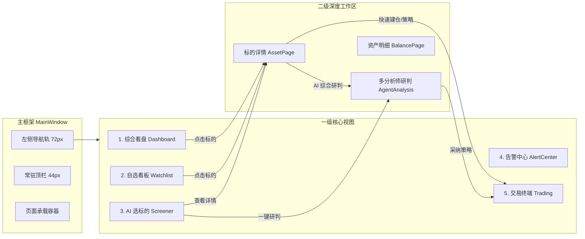

# MarketAssistant 界面设计与交互架构规范 (Design.md)

> **文档版本**: 1.2  
> **更新日期**: 2026-09-18  
> **定位**: 本文档是 MarketAssistant (跨平台金融数据与 AI 交易终端) 的完整页面设计、交互架构与重构蓝图，**当前为唯一生效的设计规范**。  
> **审视基准**: 本文档基于当前真实代码实现、金融终端业务痛点与 AI 原生交互范式建立。  
> **历史说明**: 原设计系统文档（v2.4，`docs/design-system.md`）因存在若干与代码脱节的陈旧声明与理想化偏差，已被本文档取代并**于 2026-09-12 删除**；其完整颜色 Token 对照表以 `src/MarketAssistant.App/Resources/Styles/Colors.axaml` 与 `Spacing.axaml` 为唯一事实源，可视化预览见 [`配色预览.html`](配色预览.html)，原文可通过 git 历史追溯。**v1.2（2026-09-18）**：第二章审计表所列问题已于 v1.0.0-beta1/beta2 期间全部收敛，经代码复核后更新为当前真实状态；第六章路线图同步标注完成情况。产品中长期规划见 [`roadmap.md`](roadmap.md)。

---

## 一、产品定位与核心设计哲学

### 1.1 产品定位
MarketAssistant 是一款面向高阶投资者与量化交易者的 **AI 原生金融市场工作站**。它横跨 **A 股市场**（严监管、T+1、交易时段限制、人民币计价）与 **虚拟币市场**（7×24小时、高波动、杠杆合约、USDT/BTC 计价），集成了多分析师协同（MAF Multi-Agent）、本地/外部知识库（RAG/MCP）、实时行情监控与自动化交易执行。

### 1.2 核心设计哲学
1. **金融终端的严谨 × 现代 SaaS 的克制**:
   - 杜绝花哨无意义动效，优先确保数据刷新时的极低渲染抖动与即时可读性。
   - 采用深色背景四层体系，减少长时间盯着盘面产生的眩光。
2. **AI 原生而非 AI 附庸 (AI-Native, Not AI-Addon)**:
   - 传统的 AI 助手往往只是一个悬浮侧边抽屉或独立聊天页，导致“看盘时无法对话，对话时看不到数据”。
   - MarketAssistant 将 AI 深度嵌入业务流：在资产页提供即时异动归因，在分析页提供分屏常驻伴侣（Docked Co-Pilot），在策略页提供 AI 参数回测与风险释义。
3. **闭环决策漏斗 (Closed-Loop Workflow)**:
   - 形成清晰的投资链路：**市场概览 (Home) → 标的初筛 (Screening) → 深度多智能体研判 (Analysis) → 策略回测与风控 (Strategy) → 执行与盯盘 (Trading/Alert)**。
4. **统一中的市场异构 (Dual-Market Cohesion)**:
   - 框架与交互结构统一，但底层字段、时间轴、风控维度按市场严格区分，不做生硬套用。

---

## 二、当前页面实现与设计系统差异审计 (Reality Check)

### 2026-09-18 复核结论

v1.1 审计表所列的 7 项差异**已全部在 v1.0.0-beta1/beta2 期间收敛落地**。本表更新为当前真实状态，作为收敛确认记录保留：

| 检查项 | v1.1 审计发现 | 当前代码状态（2026-09-18 核实） | 结论 |
|---|---|---|---|
| **White 硬编码文字色** | `ButtonStyles.axaml` (6处) 与 `MainWindow.axaml` (1处) 残留 `Foreground="White"` | 两文件已 **0 处**，全部收敛至 `TextOnEmphasisBrush` | ✅ 已收敛 |
| **Emoji 清理** | `AssetSelectionPageViewModel` 与 AdaptiveCard 解析器残留 Emoji | 已全部替换为 SVG 矢量资源，源码无残留 | ✅ 已收敛 |
| **数据字体 Token 化** | `AnalystResultCardView.axaml` 硬编码 Consolas 与字号 | 已统一为 `DataFontFamily` 与 `Spacing.axaml` 字号阶梯 | ✅ 已收敛 |
| **K 线图表控件封装** | Loading/Error 视图硬编码样式，未绑定主题画刷 | `KLineChartView` 已实现 `ApplyThemeToChartAsync`，随 `ActualThemeVariantChanged` 联动切换深浅主题 | ✅ 已收敛 |
| **顶栏行情条 (TopBar Ticker)** | `IndexTickers` 空置，长期隐藏 | `MainWindowViewModel.RefreshIndexTickersAsync()` 已对接市场级聚合指标，无数据时自动折叠；**仅首页根页面常驻**（`ShowIndexTickers`），设置/关于等非行情页与二级页隐藏，离开首页暂停定时刷新 | ✅ 已落地 |
| **AI 伴侣交互形态** | `DarkOverlayBrush` 遮罩置灰主报告区 | 遮罩已移除，升级为分屏常驻伴侣面板，报告始终可见 | ✅ 已落地 |
| **自选股展示模式** | 仅固定 290px 卡片的 `WrapPanel` | 已实现卡片 / 高密度表格双视图（`ShowCardView` / `ShowTableView` + `DataGrid` 列排序） | ✅ 已落地 |

> **信息密度缺口已清零（v1.3）**：`AssetPageView` 已补齐行情速览指标面板、技术指标数值面板（MA/MACD/BOLL/KDJ）、盘口深度与逐笔成交四区块，见第六章 Phase 2.4。
> **A 股盘口已接入（v1.4）**：原"未接入"判断有误——同一 `hq.sinajs.cn` 接口对个股（如 `list=sh600519`）确实返回五档买卖盘，缺的只是解析与接入（`s_*` 为指数简版，不含盘口）。现已复用同一命名客户端实现 `SinaStockQuoteClient` + `AShareOrderBookService`，AssetPage 盘口区块对 A 股与 Crypto 均生效。
> ⚠️ 该接口无官方文档，故解析器带交叉校验（字段错位即判为无数据），绝不展示错误价格。
> **A 股逐笔成交不可用（v1.5 修正）**：v1.4 误判该接口含"成交明细"——实测字段 26..29 实为卖四/卖五档位，30 起为日期时间，**接口不提供逐笔**。据此假设解析出的"逐笔"只是卖盘档位（bug），已删除；A 股 `SupportsTickTrades=false`，资产页逐笔区块对 A 股隐藏，Crypto（币安成交流）不受影响。
> **K 线与行情速览双源级联（v1.5）**：智兔 `/hs/history` 不覆盖基金/ETF（实测 404 `{"error":"not found"}`），财联社 `/quote/stock/basic` 对 ETF 返回全 null。`AShareKLineService` 与 `AShareMarketSnapshotService` 均改为"智兔/财联社优先，失败回退新浪"（`SinaKLineClient` / `SinaStockQuoteClient` 快照字段），双源均无数据时给友好文案而非原始 API 错误。
> **资产详情页布局收敛（v1.6）**：顶部卡片移除 11 项行情速览指标行——开/高/低/收/涨跌幅/振幅/成交量/成交额改由 K 线图左上角图例**逐 bar** 展示（klinecharts `candle.tooltip.custom` 回调，涨跌幅自动按涨跌着色，日期去掉日/周/月 K 无意义的 00:00，大数字改万/亿）；技术指标（主图 MA(5/10/20/30/60)+BOLL 叠加，副图 VOL/MACD/KDJ）从右栏数值面板整体迁入图表，图例与副图随周期切换实时重算；右栏仅保留快照级指标（换手率/量比/市盈率/市净率，币安等不提供的市场显示空态）+ 盘口 + 逐笔；右栏区块由灰底 `SurfaceVariantBrush` 改为与主图一致的卡片样式，并通过 `ColumnSpacing` 补齐与 K 线卡片的间距。
> **资产详情页布局收敛（v1.5）**：顶部操作按钮（自选/快捷交易/价格预警/AI分析）紧随价格信息，不再横拉卡片留空；刷新移入图表工具栏；右栏折叠开关移入右栏顶部，折叠后主图区右侧留窄条展开入口；右栏空态只显示提示行，不再渲染表头/中间价/深度条。
> **资产详情页布局收敛（v1.7）**：① 顶部卡片收敛为单行——名称+代码在左、价格+涨跌幅紧随其后、操作按钮组靠右（删除独立"较昨收"标签）；② 右栏**去掉折叠机制恒显**（v1.5 的 28px 窄条展开入口观感突兀，已删除），宽度 320→360，顺序为**行情数据 → 盘口**；③ **逐笔成交区块从详情页移除**——该数据仅币安有（`/api/v3/trades`），A 股无数据源（`NoopTickTradeService`），右栏聚焦"行情数据 + 盘口"；`CryptoTickTradeService` 保留供 Agent 工具使用，VM 侧加载管线同步删除（避免页面加载时发起无展示的请求）；④ 盘口档位 5 → 10 档（币安；A 股新浪源固定五档，头部按实际返回档位标注"五档/十档"），并新增 5s 轮询计时器补偿 A 股无实时推送（币安仍由 miniTicker 推送驱动，轮询触发被 3s 节流跳过）；⑤ 行情数据卡片在快照指标全无值（ETF/基金，财联社对该类标的返回全 null）时整卡隐藏，不再显示"暂无数据"；⑥ K 线图表工具栏新增「指标」开关浮层（MA/BOLL/VOL/MACD/KDJ + 左上角图例显隐，经 `KLineChartView` 六个 styled property 下发 `setIndicatorVisibility`，副图指标动态 `createIndicator`/`removeIndicator`），仅当次会话生效；⑦ **顶栏按内容显隐**（`ShowTopBar = ShowIndexTickers || CanGoBack`）——非首页根页面顶栏此前只剩市场切换器、形成空白带，现整条隐藏；市场切换收敛为左侧导航栏 Logo 下方的**单个市场芯片**（当前市场名 + ⇄，点击切换，与 Ctrl+M 等价），Logo 恢复为纯品牌标识不再承载切换，避免"一个功能两个入口"。

---

## 三、信息架构与导航拓扑重构

### 3.1 导航链路拓扑图



### 3.2 导航结构重构建议
1. **一级导航主项**：
   - `首页 (Dashboard)`: 市场总览、行情异动、快讯流、快捷搜索。
   - `自选 (Watchlist)`: 多分组管理、双视图切换（卡片视图 / 高密度网格表）。
   - `AI选标的 (Screener)`: 需求驱动选股、热点事件选股、量化指标初筛。
   - `交易 (Trading)`: 仅在当前市场能力支持时展示（Crypto 支持，A股隐藏或转为模拟盘/沙盘）。
   - `告警 (Alerts)`: 价格告警与风控联动门统一出口，带动态未读计数红点。
2. **底部固定项**：
   - `设置 (Settings)`: API 密钥、模型配置、知识库管理。
   - `关于 (About)`: 版本信息、环境状态。
3. **深度研判页 (AgentAnalysisPageView) 定位纠偏**：
   - 保持作为二级沉浸式工作区，但从 `AssetDetailPage` 与 `ScreenerPage` 均可平滑跳转，并在顶部提供明确的层级面包屑或返回按钮。

---

## 四、核心页面详细设计与实现蓝图

### 4.1 主窗口框架 (MainWindow & TopBar)

#### 4.1.1 现状与痛点
- 窗口原生标题栏与应用内部 TopBar 形成“双层顶栏”，浪费垂直空间 30-40px。
- ~~市场切换分段器 (`A股` / `虚拟币`) 放在顶栏右侧，但在二级页面时会被直接隐藏（`IsVisible="{Binding !CanGoBack}"`），导致在二级页面无法感知当前市场上下文。~~ → ✅ v1.7 修正：切换功能收敛为左侧导航栏 Logo 下方的**单个市场芯片**（当前市场名 + ⇄，点击切换），全页面（含二级页）恒显可点；顶栏不再承载切换功能，Logo 恢复为纯品牌标识（此前"Logo 点击切换"与可见切换器功能重复，已移除）。
- ~~顶部行情条长期空置~~ → ✅ 已于 v1.0.0-beta2 真实化：对接市场级聚合指标（A 股三大指数 / Crypto 市场级指标），无数据时自动折叠，不留空白；常驻范围收敛为仅首页根页面（设置/关于与二级页隐藏）。
- ~~非首页根页面顶栏只剩市场切换器、形成空白带~~ → ✅ v1.7 修正：顶栏改为**按内容显隐**（`ShowTopBar = ShowIndexTickers || CanGoBack`）——仅首页（行情条）与二级页面（返回 + 标题）渲染，自选/告警/AI选股/设置/关于等根页面整条隐藏，内容区顶到窗口顶部。

#### 4.1.2 重构方案
- **高度整合的紧凑顶栏 (Unified TopBar 44px)**:
  - 左侧：页面标题与返回层级（`← 返回上一页 | 标的详情 - 600519 贵州茅台`）。
  - 中间：大盘指数滚动条（A股：上证指数、深证成指、创业板指；Crypto：BTC、ETH、SOL、全网总市值）。未接入真实数据前展示骨架或折叠，不留大片空白。
  - 右侧：~~常驻市场切换胶囊（A股 / Crypto），即便在二级页面也明确标识当前市场~~ → v1.7 起市场切换胶囊移入左侧导航栏恒显（见下）；顶栏右侧改为告警铃铛与连接健康状态点的预留位。
- **左侧导航轨 (Nav Rail 72px)**:
  - 维持克制图标化设计，增加当前选中项左侧 3px 竖条（`PrimaryBrush`）与浅色底面高亮（`SelectedBackgroundBrush`）。
  - 底部告警项与顶部导航项统一支持红点/徽标显示。
  - v1.7 起 Logo 下方承载单个市场切换芯片（当前市场名 + ⇄，`CurrentMarketShortText`，点击切换、Ctrl+M 等价），全页面可用；Logo 本身为纯品牌展示，不重复承载切换。

---

### 4.2 首页大盘 (HomePageView)

#### 4.2.1 现状与痛点
- 搜索框放置在顶部独立 Card 中，输入资产跳转单一。
- Bento Grid 采用硬编码 3:2 列宽比，宽屏下左列大量留白，窄屏下右侧快讯挤压。
- 缺乏市场情绪冷热、涨跌家数分布（大盘广度 Breadth）等宏观指标。

#### 4.2.2 重构设计蓝图
```
┌────────────────────────────────────────────────────────────────────────┐
│ 🔍 全局命令搜索条 (支持拼音首字母/代码/自然语言: "找市盈率<20的新能源股")   │
├────────────────────────────────────────────────────────────────────────┤
│ 宏观晴雨表: [上涨 3,240 | 平 420 | 下跌 1,510]  成交额 1.2万亿  北向 +45.2亿 │
├───────────────────────────────────┬────────────────────────────────────┤
│ 热门标的榜单 (Hot Assets - 60%)   │ 7×24 实时快讯 (Telegraph - 40%)    │
│  [涨幅榜] [成交榜] [AI热议榜]     │  [全部] [重大利好] [风险预警]      │
│  - 标的行: 代码/名称/现价/涨跌幅  │  - 时间戳 + 情绪胶囊 + 正文摘要   │
│  - 迷你趋势折线 (Sparkline)       │  - 关联股票快捷 Tag (点击即直达)   │
├───────────────────────────────────┴────────────────────────────────────┤
│ 最近浏览历史 (横向紧凑药丸列表，支持鼠标滚轮平滑滚动)                   │
└────────────────────────────────────────────────────────────────────────┘
```

#### 4.2.3 关键技术与实现细节
- **搜索防抖与 IME 保护**: 保持当前的自绘 `Popup` + `ListBox` 模式，增加键盘 `Up/Down` 选词与 `Enter` 直达，避免原生 `AutoCompleteBox` 的拼音输入法冲突。
- **快讯卡片增强**: 引入基于正负面词法的背景色弱强调（利好浅绿背景/边框，利空浅红背景/边框），并展示关联标的代码药丸。

---

### 4.3 标的详情与行情分析 (AssetPageView)

#### 4.3.1 现状与痛点（v1.3 已收敛）
- ~~页面仅有基本价格 + 大卡片 K 线图，信息密度显著低于专业金融终端。~~ → ✅ 已补齐行情速览指标面板（今开/最高/最低/昨收/成交量/成交额/换手率/振幅/量比/市盈率/市净率）与技术指标数值面板。**v1.6 起指标位置重新收敛**：逐 bar 指标（开高低收/涨跌幅/振幅/量额）进 K 线图左上角图例，技术指标（MA/BOLL/VOL/MACD/KDJ）进图表主图与副图，右栏仅留快照级指标（换手率/量比/市盈率/市净率），顶部只保留标的信息、价格与操作。
- ~~缺少五档买卖盘（盘口）、分时成交明细（Tick 流）、技术指标数值面板。~~ → ✅ 已实现盘口深度（v1.7 起币安十档 / A 股五档，恒显右栏）；逐笔成交仅币安有数据源，v1.7 起从详情页右栏移除（服务层保留供 Agent 工具）；技术指标 v1.6 起改由图表主图/副图呈现。
- ~~用户在当前页无法直接进行快捷交易配置或加入自选操作。~~ → ✅ 操作区已有加入自选、AI 深度研判、刷新，并新增价格告警直达入口。

#### 4.3.2 重构设计蓝图（落地情况）
```
┌────────────────────────────────────────────────────────────────────────┐
│ 标的信息栏: 名称 [代码]  现价 1,820.00  +32.50 (+1.82%)                 │
│ 操作区（紧随价格，不横拉留白）: [⭐ 加入自选] [💰 快捷交易] [🔔 价格告警] [🤖 AI分析] │
├────────────────────────────────────────┬───────────────────────────────┤
│ K 线图表工作区 (主栏)                   │ 行情数据面板 (右侧，恒显 360px) │
│ - 图例 / 正在刷新提示                   │ - 换手率 / 量比 / 市盈率 / 市净率 │
│ - [⚙ 指标] [🔄 刷新] 分时/日K/周K/月K   │   （快照无指标数据的标的整卡隐藏）│
│ - 指标开关: MA/BOLL/VOL/MACD/KDJ/图例   │ - 盘口: 币安十档 / A 股五档     │
│ - 左上角图例（逐 bar）: 时间 开 高 低    │   （头部标注档位与价差）        │
│   收 涨跌幅(着色) 振幅 成交量 成交额    │ - 买卖挂单占比 / 深度条         │
│ - 主图: K线 + MA(5/10/20/30/60) + BOLL │                               │
│ - 副图: VOL / MACD / KDJ（可拖动调高）  │                               │
│ - WebView (klinecharts) 交互           │                               │
├────────────────────────────────────────┴───────────────────────────────┤
│ （v1.7 起：右栏恒显不折叠；逐笔成交区块已移除——仅币安有数据源）           │
└────────────────────────────────────────────────────────────────────────┘
```

**与蓝图的偏差（有意为之）**：
1. **底部选项卡未做**：新闻公告 / AI 异动速评 / 财务摘要移入 AgentAnalysis 报告区，详情页保持单屏可扫，避免纵向堆叠稀释主图。
2. **A 股盘口可用、逐笔移除（v1.7 修正）**：v1.4 曾据错误判断同时接入盘口与逐笔，实测该接口**不提供逐笔成交**（字段 26..29 实为卖四/卖五档位）。A 股 `SupportsTickTrades=false`；Crypto 虽有币安成交流数据，但 v1.7 起详情页右栏聚焦"行情数据 + 盘口"，逐笔成交区块整体移除（服务层保留供 Agent 工具使用）。A 股五档仍来自同一新浪接口的个股形态，`AShareOrderBookService` 对 `depth > 5` 的请求收敛到 5 档（该接口无更深档位）；币安按请求档位返回十档。
3. **数据源双源级联（v1.5）**：K 线（智兔 → 新浪）与行情数据（财联社 → 新浪）在首选源不覆盖基金/ETF 或失败时自动回退，双源均无数据才展示失败态。

**降级策略**：三个数据区块（K 线 / 行情数据 / 盘口）并行加载且互不阻塞，单区块失败只降级自身（骨架 → 提示行 + 单区块重试按钮），K 线决定整页加载状态。右栏空态只显示提示行，不渲染表头/中间价/深度条，避免"有框无数据"的异常观感；行情数据在快照指标全无值（如 ETF/基金）时整卡隐藏。盘口刷新：币安由实时价格推送驱动（≤3s 节流），A 股无推送、由 5s 轮询计时器补偿。

#### 4.3.3 K 线图表宿主技术重构
- ✅ 已完成：`KLineChartView.cs` 代码后置中的硬编码字体和字号已移除。
- ✅ 已完成：Loading/Error 面板已随应用主题画刷收敛，并通过 `ApplyThemeToChartAsync` 在深浅主题切换时同步刷新图表，不再出现闪烁与底色断层。
- ✅ 已完成（v1.6）：`kline_chart.html` 指标配置从 `createIndicator` 改为初始化 `layout`（`createIndicator(isStack=false)` 重复创建会清空同面板已有指标，无法叠加 MA+BOLL）；左上角图例改用 `candle.tooltip.custom` 回调（旧 `labels`/`values` 为 v8 参数，v9 已忽略，此前所见图例为库默认渲染）；`setCustomApi` 覆写大数字（万/亿）与日期格式；`setPriceVolumePrecision` 按数据小数位自适应，避免小市值币种显示 0.00。
- ✅ 已完成（v1.7）：新增 `stockChartInterface.setIndicatorVisibility(state)` 支持指标/图例动态开关——副图指标先经 `getIndicatorByPaneId()` 定位所在面板再 `removeIndicator`，重建时按 `INDICATOR_CONFIGS`（MA 需显式带 `calcParams`，内置默认 [5,10,30,60] 无 MA20）重新 `createIndicator`；图例开关经 `setStyles` 深切换 `candle/indicator` 的 `tooltip.showRule`。C# 侧 `KLineChartView` 暴露六个 styled property（MA/BOLL/VOL/MACD/KDJ/图例），属性变更与 WebView 导航完成时统一下发，未初始化时跳过。

---

### 4.4 AI 选标的 (AssetSelectionPageView)

#### 4.4.1 现状与痛点
- ~~界面上的三个模式卡片使用 Emoji 图标（`👤`, `📰`, `⚡`）~~ → ✅ 已替换为 SVG 矢量图标。
- 生成结果列表后，缺少多选操作、批量自选或结果横向对比功能。
- 分析执行时使用全屏阻塞蒙层，无法进行其他页面浏览。

#### 4.4.2 重构设计蓝图
- **替换 Emoji 为矢量 SVG 图标**：
  - 用户需求模式：`/Assets/Images/icon_users.svg`
  - 新闻热点模式：`/Assets/Images/icon_document.svg`
  - 快速量化模式：`/Assets/Images/icon_bolt.svg`
- **结果呈现区升级**：
  - 卡片顶部显示综合匹配度得分（Score Badge）。
  - 提供 `加入自选` 与 `发起深度研判` 双快捷按钮。
  - 增加按得分降序、按涨跌幅排序的过滤栏。

---

### 4.5 多智能体协同分析 (AgentAnalysisPageView)

#### 4.5.1 现状与交互致命伤
- ~~**遮罩抽屉冲突**~~ → ✅ 已解决：`DarkOverlayBrush` 遮罩已移除，AI 伴侣升级为分屏常驻面板，用户可边看技术分析图表/财报数字边与助手交互。
- **分析等待期黑盒**：分析中的进度展示仍偏粗粒度，未能直观呈现"哪些分析师已输出、哪些仍在运行"。

#### 4.5.2 重构设计蓝图 (分屏并列架构)
```
┌─────────────────────────────────────────────────┬──────────────────────┐
│ 研判综合看板 (主视图 65%-70%)                    │ AI 伴侣分屏 (30%-35%) │
├─────────────────────────────────────────────────┤                      │
│ [顶栏]: 标的名称/评级徽章/目标价/更多导出(⋮)     │ [常驻或一键折叠]      │
│ [Hero 卡片]: 综合评分 8.5/10 (强力买入)          │ - 结构化追问快捷词:   │
│ [分析师共识矩阵]: 基本面 | 财务 | 技术 | 情绪   │   "解释下技术面风险" │
│ [多维度卡片流]:                                  │   "若跌破支撑位如何" │
│   - 技术面卡片: 支撑压力位、指标背离图           │ - 流式对话问答流     │
│   - 财务面卡片: 营收增速、估值分位               │ - 引用报告锚点卡片   │
│   - 风险雷达: 负面舆情、解禁预警                 │ - 下拉式输入框       │
└─────────────────────────────────────────────────┴──────────────────────┘
```

#### 4.5.3 交互优势
- **无遮挡对话**: 报告始终清晰可见，AI 聊天流中引用报告观点时，点击可平滑滚动至对应报告卡片。
- **流式增量显影**: 取消中心全屏阻塞弹窗，采用顶部步骤条 + 各分析师卡片骨架屏（Skeleton）并行点亮动效。

---

### 4.6 交易终端 (TradingPageView & SubViews)

#### 4.6.1 现状与痛点
- 交易监控、策略配置、历史记录、API 配置以单调的水平 Tab 呈现。
- 策略配置界面为超长纵向展开列表（Expander），表单繁重，缺乏网格价格区间等参数的可视化直观反馈。
- 缺乏交易员紧急避险动作（如：一键全平、一键撤单）。

#### 4.6.2 重构设计蓝图
```
┌────────────────────────────────────────────────────────────────────────┐
│ 运行状态栏: 🟢 实盘运行中 | 币安现货 | 今日盈亏 +$128.50 (+2.4%) | [一键撤单] │
├───────────────────────┬────────────────────────────────────────────────┤
│ 策略与参数工作台       │ 活跃仓位与委托挂单                              │
│ - 策略选择 (网格/DCA) │ - 实时持仓列表 (开仓均价 / 标记价 / 未实现盈亏)│
│ - 可视化区间滑块设定   │ - 当前委托挂单表 (支持单笔取消)               │
│ - 风险等级与止损阈值   │ - 最近成交记录                                 │
├───────────────────────┴────────────────────────────────────────────────┤
│ 历史成交表格 (可按标的/方向/时间范围筛选并支持导出 CSV)                 │
└────────────────────────────────────────────────────────────────────────┘
```

#### 4.6.3 严格风控交互
- 任何真实下单或策略启动操作，弹出的确认框必须采用强对比度语义背景（`DangerPanelBackgroundBrush` 或 `WarningPanelBackgroundBrush`），明确显示预计最大回撤与止损线，杜绝误触。

---

### 4.7 自选看板 (FavoritesPageView)

#### 4.7.1 现状与痛点
- ~~仅提供单一卡片流（宽 290px）~~ → ✅ 已解决：已实现卡片 / 表格双视图切换（对齐 4.7.2 设计，`DataGrid` 支持列排序），数十只标的可快速多字段对比。

#### 4.7.2 重构设计
- **双模态切换 (Cards / Table View)**:
  - **卡片视图 (Card Grid)**: 适合休闲盯盘，展示大字号涨跌幅与价格。
  - **表格视图 (Dense Table)**: 适合专业看盘，单行高度 36px，等宽数字字体，支持列头点击排序（按代码、现价、涨跌幅、换手率、24小时成交额）。
- **右键上下文菜单**:
  - `查看详情`、`发起 AI 分析`、`设置价格告警`、`移出自选`。

---

### 4.8 统一告警中心 (PriceAlertPageView & AlertHistoryView)

#### 4.8.1 现状与优化
- 目前已实现 `PriceAlertRule` 与底层 `IAlertCenterService` 的对接。
- **优化点**：
  - 新建告警表单由默认展开改为紧凑抽屉或快捷弹窗，将页面首屏完全留给已有规则列表。
  - 告警历史增加按级别（Info/Warning/Critical）和标的符号的多维筛选过滤器。

---

### 4.9 设置与模型配置 (SettingsPageView & MCPConfigPageView)

#### 4.9.1 现状与优化
- 设置项结构清晰，但 RAG 知识库管理与 MCP 工具管理散落在两处。
- **优化点**：
  - 保持设置页作为全局枢纽，将“模型配置”、“知识库与向量检索 (RAG)”、“MCP 扩展工具”整合为清晰的二级导航标签，便于统一管理。

---

## 五、设计系统核心 Token 审计与收敛标准

针对当前代码库中未完全收敛的颜色与尺寸，强制执行如下映射规范：

### 5.1 文字与强调色 (On-Color)
- **绝对禁止使用纯文本字面量 `Foreground="White"`**。
- 一律引用 `{StaticResource TextOnEmphasisBrush}`。
- 当处于警告色或浅底容器时，文字需采用对应的语义文字刷（如 `WarningPanelTextBrush` / `SuccessPanelTextBrush`）。

### 5.2 数字字体规范
- 所有价格、涨跌百分比、成交量、资金数值一律指定：
  ```xml
  FontFamily="{StaticResource DataFontFamily}"
  ```
  该 Token 在深色主题下启用等宽对齐，严禁在个别控件中自行拼写 `"Consolas, 'Cascadia Mono'"`。

### 5.3 涨跌标签规范
- 摒弃早期“纯文字变色”方案，全面采纳“12% 透明度背景色块 + 同色加粗前景文字”：
  - 上涨标签背景：`{StaticResource BullishTagBackgroundBrush}`
  - 下跌标签背景：`{StaticResource BearishTagBackgroundBrush}`
  - 平盘标签背景：`{StaticResource NeutralTagBackgroundBrush}`

---

## 六、实施与重构路线图 (Implementation Roadmap)

### Phase 1: 规范与硬编码收敛 (阻断级修正) —— ✅ 已全部完成（2026-09-18 复核确认）
1. **清理 `Foreground="White"` 遗留**：✅ `ButtonStyles.axaml` 与 `MainWindow.axaml` 已全部收敛为 `TextOnEmphasisBrush`（复核两文件 0 处残留）。
2. **根除残留 Emoji**：✅ `AssetSelectionPageViewModel` 与 AdaptiveCard 解析器已全面切换为 SVG 矢量资源。
3. **消除 `AnalystResultCardView` 本地字体声明**：✅ 已替换为 `DataFontFamily`，字号收敛至 `Spacing.axaml` 阶梯。
4. **重构 `KLineChartView.cs` 的 Loading/Error 视图**：✅ 已随主题画刷重构，并支持运行时主题切换。

### Phase 2: 交互体验深度优化 (核心交互破局) —— ✅ 5/5 已完成
1. **AgentAnalysis 侧边栏交互改造**：✅ 遮罩式抽屉已移除，升级为平铺分屏 / 可折叠伴侣面板，实现边看深度报告边对话。
2. **FavoritesPageView 双视图改造**：✅ 已新增专业级金融数据表格视图（`DataGrid` 带列排序）。
3. **TopBar 行情条真实化**：✅ 已对接市场级聚合指标数据源，无数据时自动折叠。A 股取三大指数（上证 / 深证成指 / 创业板指）；Crypto 取对等市场级指标（全网总市值+24h涨跌幅、BTC 主导率、恐惧贪婪指数）。**禁止展示具体标的价格**（如 BTC/ETH/SOL 单价），其语义与"市场指数"不对等。**常驻范围为仅首页根页面**（`MainWindowViewModel.ShowIndexTickers` = `HasIndexTickers && IsOnHomeRootPage`）：行情条是首页盯盘的背景信息，自选/告警/设置等其余根页面与二级详情页一律隐藏，避免与页面无关的市场指数分散注意力；离开首页时同步暂停 30s 定时刷新，回到首页立即补刷。（v1.7 曾试过"与切换器同规则、所有根页面常驻"以消除设置页"只有切换器没有行情条"的不一致，实际观感上设置页常驻行情条反而多余，v1.7 后期改回仅首页。）
4. **AssetPageView 信息密度提升**：✅ 已完成——已增补行情速览指标面板、技术指标数值面板（MA/MACD/BOLL/KDJ）、盘口深度与逐笔成交，并新增价格告警直达入口与右栏折叠开关。盘口对 A 股与 Crypto **均已接入**（A 股经新浪个股行情接口）；逐笔成交仅 Crypto 接入（A 股数据源不提供，见第二章 v1.5 说明）。四区块并行加载、单区块失败只降级自身。K 线与行情速览在首选源不覆盖基金/ETF 时回退新浪（见第二章 v1.5 双源级联说明）。
5. **导航尺寸收敛**：✅ 已收敛至 `Spacing.axaml` Token（`NavItemSize=44` / `NavIconSize=22`）。

### Phase 3: 交易与智能化高级演进 —— ⬜ 未开始
1. **TradingPageView 策略可视化**：为网格/定投策略增加价格区间与止损线的图形化预览。
2. **紧急避险控制中心**：在交易状态栏增加经过二次校验的一键全平/一键撤单快捷通道。
3. **多窗口/面板拆分支持**：探索 Avalonia 跨屏幕/可拖拽浮动窗口，支持专业交易员多显示器同时盯盘与对话。
